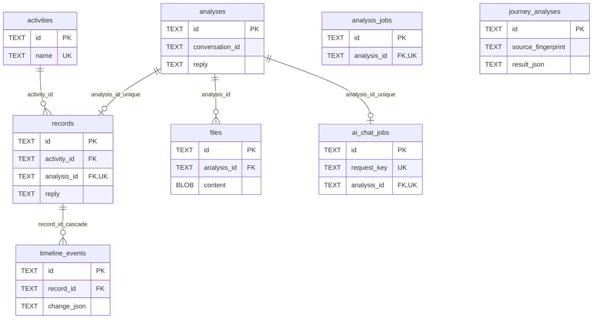

# ERD와 논리 참조

기준일: 2026-11-06. [DB 컬럼 정의](데이터베이스_정의서.md)

다음 선은 논리 참조 관계다. 물리 DB에서는 FK 또는 동등한 무결성 검사로 구현한다. 하나의 초안은 최대 한 확정 기록과 연결된다. 현재 홈 저장은 초안 참조가 필수다. 이전 개발용 작업 테이블은 제외했다.

journey_analyses는 JSON 근거를 가진 독립 스냅샷이다. files와 records는 analysis_id를 통해 연결한다. 기록 삭제는 그 Timeline도 함께 제거해야 하며 DB CASCADE 또는 동등한 트랜잭션으로 구현한다.

| JSON·논리 ID | 참조 | DB 보장·처리 |
| --- | --- | --- |
| analyses.conversation_id | 브라우저 대화 ID | conversation 테이블·사용자 FK 없음 |
| reply.analysis.activity.id / update.activityId | activities.id | 서버에서 존재 검증. JSON 내부 FK 없음 |
| reply.analysis.files[].name | files.name | 자료 ID와 안정된 응답 순서를 함께 유지. 같은 이름의 다른 자료를 구분 |
| change_json.evidence[] | 이름·원문 | 같은 기록 안의 유일한 이름만 자료 링크로 변환, 모호한 근거는 문자열 표시 |
| input_json.files[].id | files.id | AI 작업 입력 메타정보, JSON 내부 FK 없음 |
| Journey evidence.recordId | records.id | AI·백엔드에서 존재·인용 검증 |
| Journey event.activity.id | activities.id | 이벤트 근거에 해당 활동 기록이 있는지 검증 |
| record:ID | records.id | 링크 자료의 조회용 ID. files 행 없음 |

저장·삭제 순서는 [저장과 삭제 규칙](저장과_삭제_규칙.md)을 따른다.
